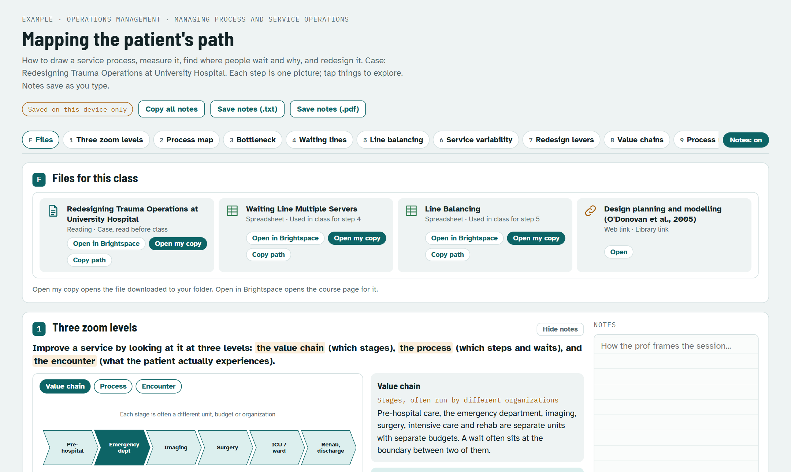
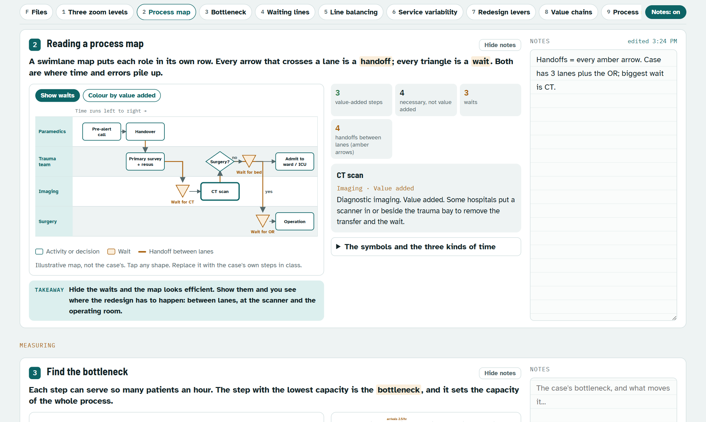
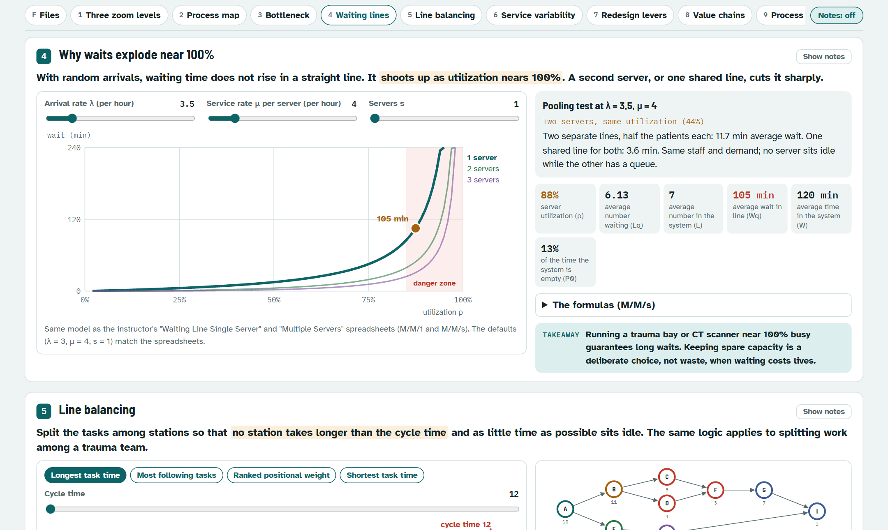
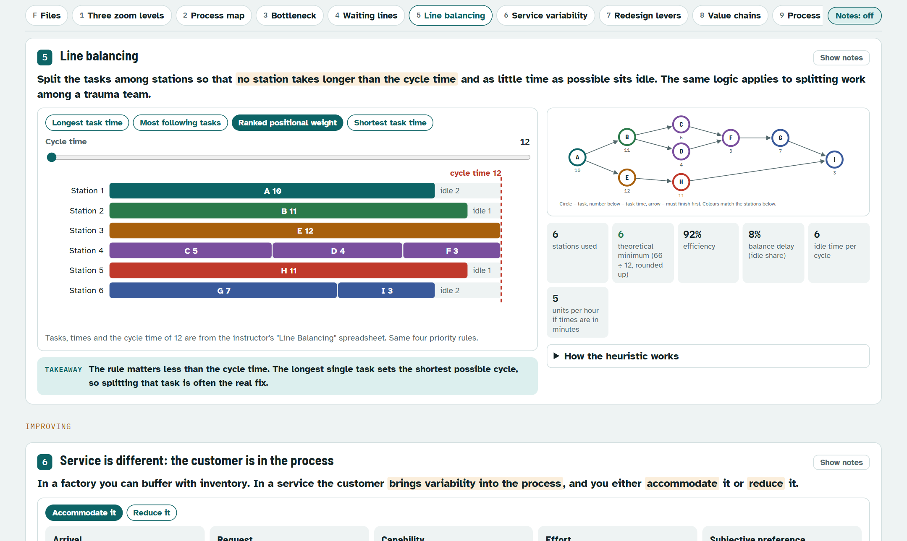
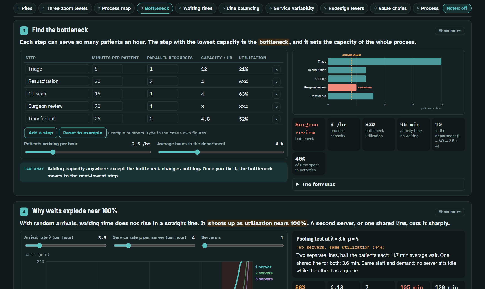
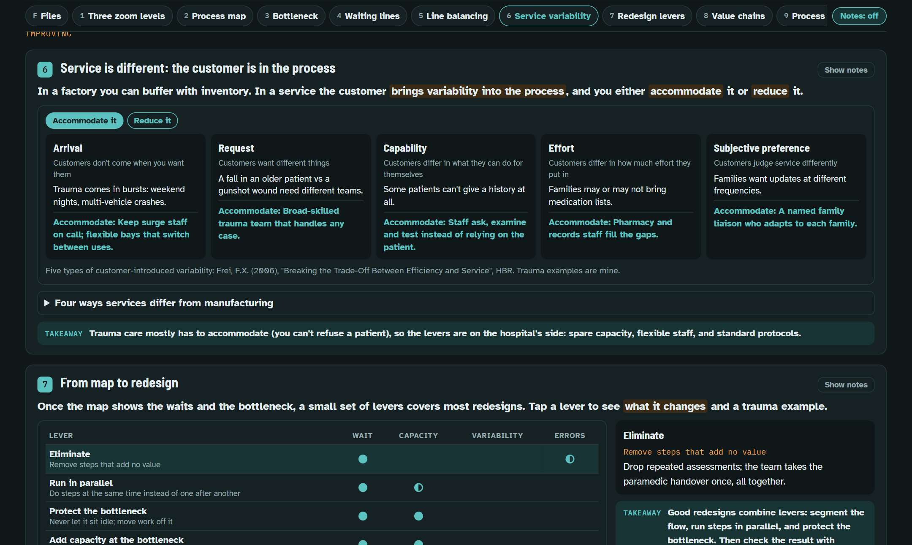

# class-notes-page

A [Claude Code](https://claude.com/claude-code) skill for students. It pulls your course material from Brightspace into your own folders, keeps a schedule of your classes, and builds an interactive study page for each session before it happens.

Each page walks through the session one step at a time. Every step has a diagram you can work with (sliders, clickable charts, process maps, draggable 2x2s, rating tables), a one-line takeaway, and a private note pad. Each step is laid out to fit one laptop screen, and you can hide all the note pads with one button.

Open `examples/ops-process-service/page.html` in a browser to see a finished page.

## What a page looks like

Screenshots from the example page (an operations class on process and service redesign).

**The top of a page.** Save or copy your notes, jump to any step, switch every note pad on or off at once, and open the class files (readings, case, the instructor's spreadsheets) straight from Brightspace or from your own downloaded copy.



**One step per screen, with your notes beside it.** Tap any shape in the diagram for an explanation; the tiles count what the map shows.



**Notes hidden, diagram full width.** Sliders drive the same model as the instructor's spreadsheet, with the results updating as you move them.



**Try the method yourself.** Switch the rule or the cycle time and watch the stations rebalance.



**Type in the case's own numbers.** The table finds the bottleneck and applies Little's Law. Pages follow your light or dark setting.



**Frameworks as things you can switch.** Here, five kinds of customer variability, each with a way to accommodate it or reduce it.



## What it does

1. **Setup (once a term).** Asks for your Brightspace address and where to save files, lists your courses through the Brightspace API, and reads each course outline's AI policy.
2. **Sync.** In your own signed-in browser tab, it collects every file in your courses' content, assignment attachments, announcement attachments, the course calendar and the assignment due dates. Everything downloads as one zip (after you say yes), which is then filed into `<your folder>/<course>/materials/`. You also get a `Course_Index.html` per course and a `Schedule.html` of sessions and deadlines.
3. **Study pages.** For each upcoming session it reads the readings, case and the instructor's spreadsheets, then builds the page, checks that every step fits the screen, reviews screenshots, and publishes it as a private claude.ai Artifact (or saves a local HTML file).

## Requirements

- Claude Code, with the [Claude in Chrome](https://claude.com/chrome) extension for the Brightspace sync.
- Python 3.9+ and Node.js 18+.
- For the screen-fit check: `npm install -g puppeteer`.
- Optional: `pdftotext` (Poppler) to read PDFs, `pip install openpyxl` to read spreadsheets, `pip install tzdata` on Windows for time zones.
- Brightspace (D2L) is the only LMS supported for sync. With another LMS, put your files in the course folders yourself; the study pages work the same way.

## Install

```bash
git clone https://github.com/vinistoisr/class-notes-page ~/.claude/skills/class-notes-page
```

Then, in Claude Code: "set up my courses with class-notes-page". After that: "prep my classes", "sync Brightspace", or "make a study page for OPS 500 session 4".

Your settings live in `~/.class-notes-page/config.json`, outside the skill folder, so updating the skill never touches them.

## What it will not do

- It never signs in for you. If Brightspace shows a sign-in page, you sign in, then ask again.
- It only reads what your own account can already see, through Brightspace's official API, in your browser.
- Readings that are links to library databases, publishers or purchased case packs can't be downloaded this way. They are listed in each course index for you to open.
- It doesn't decide your academic integrity questions. It reads each course's AI policy and, where AI analysis of graded work is not allowed, builds pages that lay out the evidence and leave the judgement to you. You are still responsible for following your course rules.

## Files

| Path | Purpose |
|---|---|
| `SKILL.md` | Instructions Claude follows. |
| `shell/` | Shared page shell: CSS, private notes, notes switch, screen-fit layout. |
| `build.py` | Builds a page from a page folder; flags steps without a diagram or takeaway. |
| `check_fit.js` | Measures each step at 1280x680 and 1536x730 with notes on and off; screenshots. |
| `lms/d2l_sync.js` | Browser-side Brightspace sync (discover, plan, one-zip download). |
| `lms/unpack.py` | Files the zip into course folders; writes course indexes and calendar events. |
| `lms/test_d2l_sync.js` | Offline test of the sync against a mock Brightspace. |
| `schedule/upcoming.py` | Upcoming sessions and page status; writes `Schedule.html`. |
| `examples/` | A finished page with its source. |

## Copyright

Downloaded course material stays on your computer. Don't commit readings or cases to a public repository.

## License

MIT
